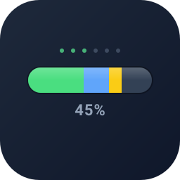
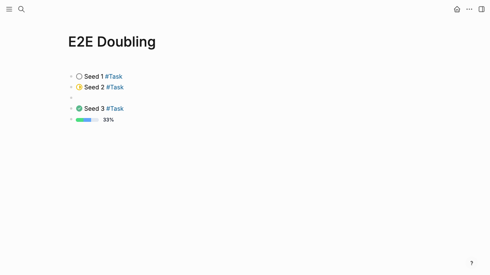

# Logseq Progress Bar Plugin



Visualize task completion as segmented progress bars in Logseq DB graphs.

Track progress derived from configurable properties (`status`, `state`, or any custom enum) on blocks with specified tags (`#Task`, `#Project`, etc.). Supports manual placement, query integration, and real-time updates.

**DB graphs only** — file-based graphs are not supported.



---

## Installation

### From Local Build

1. Clone the repo and build:

   ```bash
   cd logseq-progressbar
   npm install
   npm run build
   ```

2. In Logseq, go to **Settings → Advanced → Enable Developer mode**
3. Open **Plugins** (three-dot menu → Plugins)
4. Click the three-dot menu in the Plugins panel → **Load unpacked plugin**
5. Select the `logseq-progressbar` directory

### Development

```bash
npm run dev         # Rebuild dist/ on change
npm run dev:serve   # In a second terminal: serve dist/ over HTTP for Logseq to load
npm run test        # Run unit tests
npm run typecheck   # Strict TypeScript check
npm run build       # Production build
```

With both `dev` and `dev:serve` running, load the plugin in Logseq via
**Plugins → Load plugin from web url** → `http://127.0.0.1:8080/`

---

## Usage

### Basic — Slash Command

Type `/progress-bar` in any block to insert a progress bar that tracks child blocks.

### Manual — Renderer Macro

Insert the macro directly:

```txt
{{renderer :progress-bar}}
```

The bar scans descendant blocks for configured tags and aggregates their statuses.

### With Overrides

Override any global setting per-instance:

```txt
{{renderer :progress-bar, tags: Task|Bug, property: status, format: both}}
```

```txt
{{renderer :progress-bar, tags: Project, property: state, complete: Completed, width: 300px}}
```

### With a Query

Drop the renderer directly into a Logseq query block (the bar is auto-detected
from `:logseq.property/query`):

```txt
{{renderer :progress-bar}}
```

Both query forms are supported:

- **Simple DSL** — Logseq's query DSL. The `(task …)` clause defines which statuses are tracked:
  ```clj
  (task "Todo" "Doing" "Done")
  ```

- **Custom datascript** — full datalog as a `{:query […]}` map or a bare
  `[:find …]` vector. The `:find` clause must pull blocks (`(pull ?b [*])`
  or an equivalent shape):
  ```clj
  {:query [:find (pull ?b [*])
           :where
           [?b :logseq.property/status ?s]
           (or [?s :db/ident :logseq.property/status.todo]
               [?s :db/ident :logseq.property/status.doing]
               [?s :db/ident :logseq.property/status.done])]}
  ```

To attach a bar to a query block from elsewhere on the page, pass its UUID:

```txt
{{renderer :progress-bar, query: 69acb093-df21-438d-9bae-72decf188ed2}}
```

Either way, results are grouped by the tracked property (`status` by default)
and counted in the plugin.

---

## Renderer Parameters

All parameters are optional. Global plugin settings are used as defaults.

| Param      | Example                    | Description                                      |
| ---------- | -------------------------- | ------------------------------------------------ |
| `tags`     | `tags: Task\|Bug`          | Tags to track (pipe-separated)                   |
| `property` | `property: state`          | Property to read for progress                    |
| `complete` | `complete: Done\|Canceled` | Values that count as "complete" (pipe-separated) |
| `depth`    | `depth: 2`                 | Scan depth (`1`, `2`, ..., or `all`)             |
| `strict`   | `strict: true`             | Only count blocks with matching tags             |
| `format`   | `format: both`             | Label format: `percent`, `fraction`, or `both`   |
| `width`    | `width: 200px`             | Bar width: `full`, `compact`, or CSS value       |
| `query`    | `query: <uuid>`            | Track a query block's results                    |

---

## Settings

Open **Plugins → Progress Bar → Settings** to configure global defaults.

### Tag & Property Configuration

| Setting           | Default                | Description                                         |
| ----------------- | ---------------------- | --------------------------------------------------- |
| Tags in Scope     | `Task, Checklist`                            | Comma-separated tag names to track                                                          |
| Property Mappings | `{"Task": "status", "Checklist": "check"}`   | JSON mapping each tag to its progress property. Checkbox-typed properties self-bucket (`true` → Done, `false` → Todo). |
| Complete Values   | `{"status": ["Done"]}`                       | JSON mapping each property to its "complete" values (string properties only — booleans bypass this). |

### Display Settings

| Setting              | Default   | Description                                   |
| -------------------- | --------- | --------------------------------------------- |
| Default Scan Depth   | `all`     | How deep to scan (`all` or a number)          |
| Strict Tag Filtering | `false`   | Exclude untagged blocks from the count        |
| Display Format       | `percent` | `percent` (54%), `fraction` (7/13), or `both` |
| Bar Width            | `full`    | `full` (100% width) or `compact` (inline)     |
| Auto-Detect Mode     | `true`    | Auto-show bars on blocks with tagged children |
| Show on Empty        | `false`   | Show an empty 0% bar when no items match      |

### Color Overrides

Override segment colors per status value (JSON):

```json
{
  "Done": { "light": "#22c55e", "dark": "#16a34a" },
  "Doing": { "light": "#3b82f6", "dark": "#2563eb" }
}
```

---

## Default Colors

| Status       | Light Mode | Dark Mode |
| ------------ | ---------- | --------- |
| Done         | #4ade80    | #22c55e   |
| Doing / Now  | #60a5fa    | #3b82f6   |
| In Review    | #facc15    | #eab308   |
| Todo / Later | #e2e8f0    | #475569   |
| Backlog      | #f1f5f9    | #334155   |
| Canceled     | #fca5a5    | #ef4444   |

Colors adapt automatically to Logseq's dark/light theme.

---

## How It Works

1. The renderer macro triggers on `{{renderer :progress-bar, ...}}`
2. Global settings are merged with per-instance overrides
3. Descendant blocks (or query results) are scanned at the configured depth
4. Blocks are filtered by tags in scope
5. The tracked property is read from each block; blocks with no value are skipped
6. Status counts are aggregated and a completion percentage is calculated
7. A segmented pill-shaped bar is rendered with completed segments on the left
8. Hovering shows a tooltip with the full status breakdown
9. The bar updates in real-time when task statuses change (`DB.onChanged`)

---

## Examples

### Track tasks under a project block

```txt
- Project Alpha #Project
  - Design UI #Task (status: Done)
  - Implement API #Task (status: Doing)
  - Write tests #Task (status: Todo)
  - {{renderer :progress-bar}}
```

Result: segmented bar showing 1/3 complete (33%).

### Track with custom property

```txt
- Q1 Goals
  - Launch product #Project (state: Completed)
  - Hire team #Project (state: Now)
  - Raise funding #Project (state: Later)
  - {{renderer :progress-bar, tags: Project, property: state, complete: Completed}}
```

### Compact inline bar with fraction

```txt
- Sprint 12 {{renderer :progress-bar, format: fraction, width: 200px}}
  - Fix login bug #Task (status: Done)
  - Add search #Task (status: Doing)
  - Update docs #Task (status: Todo)
```

### Track a checklist with clickable checkboxes

The plugin ships `#Checklist` → `check` (a `:checkbox` property) as a built-in
default in settings. Tag children with `#Checklist` (or your own class that
declares a `:checkbox` property) — Logseq renders a native clickable checkbox
on the left of the block, and the progress bar updates in real time as you
toggle items.

```txt
- Trip prep {{renderer :progress-bar}}
  - ☐ Book flights #Checklist
  - ☑ Pack passport #Checklist
  - ☑ Confirm hotel #Checklist
  - ☐ Notify cat-sitter #Checklist
```

Result: 2/4 complete (50%). `true` lands in the **Done** bucket, `false` in
**Todo**. The plugin does **not** create the `#Checklist` class or `check`
property — author them yourself (or rename in settings to point at any class
you've already built, e.g. `{"MyChecklist": "done"}`).

Checkbox and enum-status children can live under the same parent — they roll
up into one bar.

---

## Development

### Project Structure

```txt
src/
├── types.ts        — Shared TypeScript types
├── parser.ts       — Renderer macro argument parser
├── config.ts       — Plugin settings schema + config resolver
├── scanner.ts      — Block scanning (children, page, query)
├── aggregator.ts   — Status counting + completion calculation
├── colors.ts       — Color palette + segment ordering
├── renderer.ts     — HTML rendering + CSS styles
├── index.ts        — Main entry: triggers, events, lifecycle
├── query.ts        — Query classifier, DSL→datalog, entity adapter, pull enricher
├── debug.ts        — Verbose-log helper (gated by `debug` setting)
└── __tests__/      — Unit tests (105 tests across 12 files)
```

### Running Tests

```bash
npm test            # Run once
npm run test:watch  # Watch mode
```

---

## Privacy

The plugin runs entirely inside your Logseq client. It reads block properties,
runs Datascript queries against the loaded graph, and writes the rendered bar
back through Logseq's plugin UI surface. **No data leaves the client** — there
are no external network calls, no telemetry, and no third-party services.

Settings (tags, property mappings, color overrides) are stored by Logseq in
its standard plugin-settings file alongside other plugin settings.

---

## License

MIT
